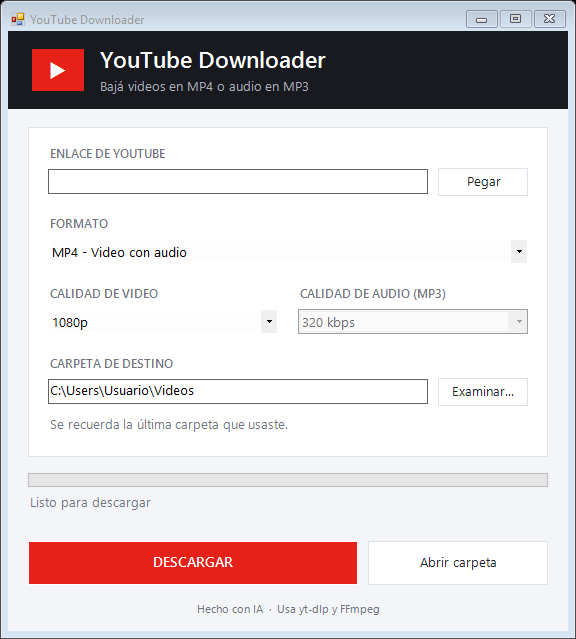

# YouTube Downloader (Windows)

Una ventanita simple para bajar videos de YouTube en **MP4** o el audio en **MP3**, sin instalar programas raros ni entrar a páginas con publicidad.



> ⚠️ **Aclaración importante:** este proyecto **no lo programé yo**. Lo hizo una inteligencia artificial:
> la primera versión la armó **ChatGPT** (OpenAI) y después **Claude** (Anthropic, con Claude Code) corrigió los errores, mejoró la interfaz y agregó funciones.
> Yo solo lo pedí y lo probé. Lo comparto gratis por si a alguien le sirve. No vendo nada.

## Qué hace

- Baja videos en MP4 (1080p, 720p, 480p, 360p, 1440p, 4K o la mejor calidad disponible).
- Baja solo el audio en MP3 (320, 256, 192 o 128 kbps).
- Los MP4 se bajan en H.264 + AAC para que se vean y escuchen en el reproductor de Windows.
- **Se acuerda de la última carpeta** donde guardaste.
- Barra de progreso con velocidad y tiempo restante, botón para cancelar y botón "Pegar" el enlace.

## Qué necesitás

Windows 10 u 11. El programa usa dos herramientas gratuitas que se instalan con un comando cada una.
Abrí **PowerShell** y escribí:

```powershell
winget install yt-dlp.yt-dlp
```

```powershell
winget install Gyan.FFmpeg
```

Después cerrá y volvé a abrir la sesión (o reiniciá) para que Windows las encuentre.

## Cómo usarlo

1. Descargá este repositorio (botón verde **Code → Download ZIP**) y descomprimilo.
2. Hacé doble clic en **`YouTube-Downloader.bat`**.
3. Pegá el enlace, elegí formato, calidad y carpeta, y tocá **DESCARGAR**.

La última carpeta usada se guarda en `%APPDATA%\YouTube-Downloader\ultima-carpeta.txt`.

## Si deja de funcionar

YouTube cambia cosas seguido. Casi siempre se arregla actualizando yt-dlp:

```powershell
winget upgrade yt-dlp.yt-dlp
```

## Proyectos que usa (créditos)

Todo el trabajo pesado lo hacen estos proyectos libres, no este script:

- [yt-dlp](https://github.com/yt-dlp/yt-dlp): descarga los videos.
- [FFmpeg](https://ffmpeg.org/): une video y audio, y convierte a MP3.
- PowerShell y Windows Forms (vienen con Windows): la ventana.
- Hecho con [ChatGPT](https://chatgpt.com/) y [Claude](https://claude.ai/).

## Aviso legal

- Este proyecto **no tiene relación** con YouTube ni con Google.
- Usalo solo para bajar contenido que tengas derecho a descargar (tus propios videos, contenido libre o con permiso del autor). Respetá los derechos de autor y las condiciones de uso de YouTube.
- Se entrega "tal cual", sin garantía de ningún tipo.

## Licencia

Dominio público ([The Unlicense](LICENSE)): podés usarlo, copiarlo y modificarlo como quieras.
